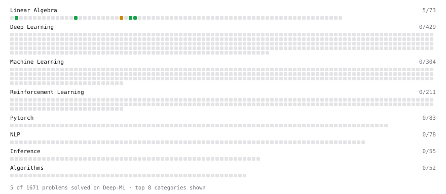

# Deep-ML

My machine learning practice from [Deep-ML](https://www.deep-ml.com). Every solution here was written by hand.

**4** solved · 4 problems · 0 labs · 0 math

[**Browse the interactive portfolio**](https://myunduck.github.io/deep-ml/) to replay this filling in over time.

## Problems

| | Difficulty | Solved | |
| --- | --- | --- | --- |
| [Convert Vector to Diagonal Matrix](https://www.deep-ml.com/problems/35) | easy | 2026-10-11 | [solution](problems/0035-convert-vector-to-diagonal-matrix) |
| [Dot Product Calculator](https://www.deep-ml.com/problems/83) | easy | 2026-10-23 | [solution](problems/0083-dot-product-calculator) |
| [Transpose of a Matrix](https://www.deep-ml.com/problems/2) | easy | 2026-10-10 | [solution](problems/0002-transpose-of-a-matrix) |
| [Find the column space of a matrix](https://www.deep-ml.com/problems/68) | medium | 2026-10-23 | [solution](problems/0068-find-the-column-space-of-a-matrix) |

---

_This file is regenerated by Deep-ML on every push._
